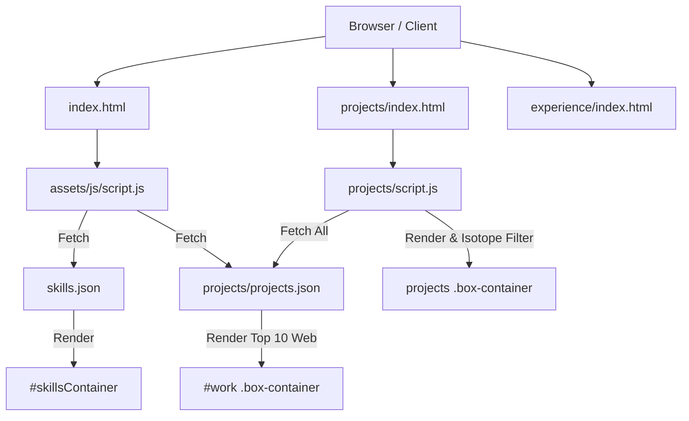

# Code Analysis Report: My-Portfolio Web Application

## Executive Summary
This document provides a comprehensive code analysis and structural review of the **My-Portfolio** web application codebase located at `d:\GitHub\My-Portfolio`. The project is a responsive, feature-rich developer portfolio built using HTML5, CSS3, JavaScript (ES6+), jQuery, and dynamic JSON data fetching.

---

## 🏗️ 1. Architecture & Project Structure

### Workspace File Map
```
My-Portfolio/
├── index.html                 # Primary single-page portfolio landing page
├── 404.html                   # Custom fallback 404 page
├── skills.json                # JSON dataset for technical skills & Icon URLs
├── README.md                  # Project readme
├── assets/
│   ├── css/
│   │   ├── style.css          # Main site stylesheet (1200+ lines, responsive grid/flexbox)
│   │   └── 404.css            # Styles for custom 404 page
│   └── js/
│       ├── script.js          # Core application logic (Data fetch, DOM injection, EmailJS, ScrollSpy)
│       ├── app.js             # Particles.js configuration & initialization
│       ├── 404.js             # Basic navigation handler for 404 page
│       └── particles.min.js   # Third-party particle background engine
├── experience/
│   ├── index.html             # Detailed experience timeline page
│   ├── script.js              # Experience page interactivity & visibility listeners
│   └── style.css              # Timeline component layout & styling
└── projects/
    ├── index.html             # Multi-project catalog page with grid filtering
    ├── script.js              # Projects page dynamic fetch, rendering & Isotope plugin logic
    ├── style.css              # Grid layout styling & tilt effect adjustments
    └── projects.json          # Complete JSON dataset (34+ projects metadata & links)
```

### Component Data & Render Flow


---

## 🛠️ 2. Detailed Technical Breakdown

### A. Core Frontend Stack
- **HTML5 & Semantic Structure:** High accessibility markup with standard sectioning (`header`, `section`, `nav`, `footer`). Key interactivity enhanced via `aria-label` attributes on icon links.
- **CSS Design System:**
  - Standardized root values (`font-size: 62.5%` for easy `rem` calculation).
  - Modern color palette: Deep navy/purple gradients (`#57059e` to `#4a00e0`), dark work cards (`#000031`), and vibrant accent highlights (`#ffd900`, `#ff7b00`).
  - Mobile-first responsiveness handled via clean `@media` query breakpoints (`max-width: 768px`, `max-width: 600px`, `max-width: 450px`).
- **JavaScript & External Dependencies:**
  - **jQuery (v3.6.0):** DOM manipulation, event binding, mobile menu toggle, smooth scrolling animation.
  - **Typed.js (v2.0.5):** Animated typewriter text cycle in hero banner (`fullstack developer`, `backend development`, `web designing`, `graphic designing`).
  - **Particles.js:** Interactive canvas particle background in the Hero section.
  - **Vanilla Tilt (v1.7.0):** 3D card tilt transformations on hover.
  - **ScrollReveal:** Scroll-triggered animated element reveals.
  - **EmailJS (v3):** Client-side direct email sending for contact form submissions.
  - **Isotope JS (v3.0.6):** Dynamic grid filtering and masonry layouts for the projects showcase page.
  - **Tawk.to:** Live chat widget integration.

---

## 🔎 3. Code Audit & Discrepancy Findings

| Category | Component / File | Description & Impact | Recommendation |
| :--- | :--- | :--- | :--- |
| **Attribution / Branding** | `experience/index.html`, `404.html`, `index.html` | Template title tags & credit links point to original template author (`Jigar Sable`). | Update `<title>`, footer credits, and repository links to `Prajjwal Upadhyay`. |
| **Pathing Issue** | `projects/script.js`, `assets/js/script.js` | Image paths use absolute domain roots (`/assets/images/...`). Breaks on sub-directory hosting like GitHub Pages (`user.github.io/My-Portfolio/`). | Change absolute paths to relative paths (`./assets/images/...` or `../assets/images/...`). |
| **Disabled Feature** | `index.html` (L308-395) | Main Experience timeline section is commented out in root HTML. | Uncomment and populate if experience section should be visible on home page. |
| **Disabled Feature** | `projects/index.html` (L50-56) | Isotope filter buttons (`MERN`, `LAMP`, `Basic Web`, `Android`) are commented out. | Uncomment filter button container `#filters` to re-enable interactive portfolio filtering. |
| **Data Cleanliness** | `projects/projects.json` | Contains duplicate project entries at lines 313–341 (*Indian Temples* repeated 3 times). | Deduplicate JSON array items. |
| **Security / Dev UX** | `assets/js/script.js` | Anti-pattern `oncontextmenu="return false"` and `F12` key blocking present. | Remove key/right-click blockers as they do not secure web code and degrade user accessibility. |

---

## 🎯 4. Summary & Action Plan

1. **Brand Personalization:** Update remaining template metadata and footer links across all pages (`experience/index.html`, `404.html`, `index.html`).
2. **Relative Routing Fix:** Standardize asset paths to use relative directory markers so images load reliably across all deployment targets.
3. **Enable Filter UI:** Uncomment the filter buttons in `projects/index.html` to leverage the existing Isotope filter JavaScript logic.
4. **Data Hygiene:** Clean up duplicated items in `projects/projects.json`.
